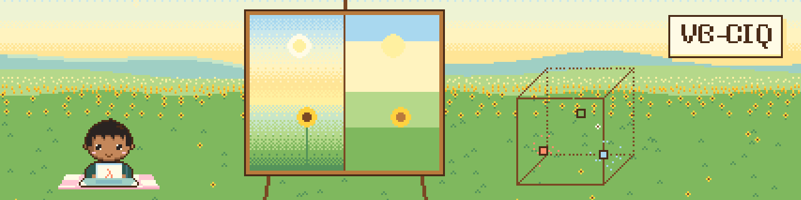

<p align="center"></p>

# VB-CIQ

Graph-based colour palette selection, benchmarked against octree, K-means, maximum coverage and median cut. Unpublished research code from VIT Vellore (2022); the write-up is `Vector-Based-Approach-For-Color-Image-Quantization.pdf`.

## Run it

```bash
pip install numpy pillow opencv-python scikit-image matplotlib jupyter
```

VB-CIQ is in `VB-CIQ/ROW.ipynb`. Each benchmark folder (`K-MEANS/`, `OCTREE/`, `FASTOCTREE/`, `MAXIMUM/`, `MEDIAN CUT/`) runs with `python main.py` and writes to `results/`; `results/results.ipynb` makes the tables. The method, test images and full results: [docs/about.md](docs/about.md).

## Build and test

```bash
make check    # compiles the code and checks the notebooks; CI runs it
```

Finished, not published; see [STATUS.md](STATUS.md). MIT licence, written with Navneet Melarkode.
